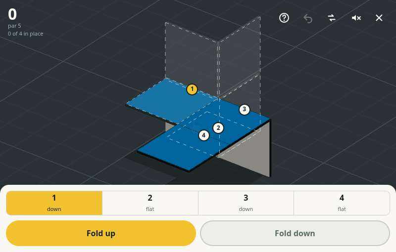

# Foldline Daily

**How few folds does it take to fit today's silhouette?**



Foldline Daily is a paper-folding puzzle inside a Reddit post. Each day brings a new
shape. Fewest folds wins, with time breaking ties.

[Play on Reddit](https://www.reddit.com/r/FoldlineDaily/comments/1y1uv2a/day_1_six_panels_two_corners_par_7/) ·
[58.5-second demo](https://youtu.be/WoT1h9iPjf4) · [Devpost](https://devpost.com/software/foldline-daily)

The demo shows a complete five-fold solve at par and a private replay. The on-screen label identifies the local harness and its simulated Devvit endpoints throughout.

## How to play

1. [Open a puzzle on Reddit](https://www.reddit.com/r/FoldlineDaily/comments/1y1uv2a/day_1_six_panels_two_corners_par_7/) and look for the outline on the mat.
2. Drag a panel to fold its hinge by 90°, or select a numbered hinge and tap **Fold up** or **Fold down**. On a keyboard, use the number keys and arrows.
3. Match the outline in as few folds as you can. Undo costs a fold. Your first solve on the daily board counts, and you can practice afterward.

Check your result against par, replay your folds privately, try the leaderboard, or share a spoiler-free grid.
Refreshing the same tab keeps your unfinished folds and timer.
After solving, you can build a Community Route for other players.

## How it uses Devvit

Devvit Web runs the puzzle in an Interactive Post. A scheduled task publishes the
daily board, and the server replays moves before saving results in Redis. Reddit
comments, votes, and flair support result sharing, Sunday Community Routes, and streaks.

## Quickstart

From a fresh clone with Node 24.18+:

```sh
npm ci && npm run harness -- --open /src/client/game.html
```

This opens the local puzzle with a simulated Reddit backend.
[Demo subreddit](https://www.reddit.com/r/FoldlineDaily/) ·
[Devvit app listing](https://developers.reddit.com/apps/contrarian-daily) ·
[Development](docs/development.md) · [Playtest](docs/playtest.md) ·
[License](LICENSE)

The game is Foldline Daily. The Devvit listing slug is `contrarian-daily`, the id Reddit assigned when the app was first uploaded. That slug cannot be renamed. Details are in [Development](docs/development.md#devvit-app-name).

## Ported from Foldline

Foldline Daily ports the puzzle engine from the [original WebXR game](https://foldline-meta-start-2026.vercel.app/).
The Reddit Game of the Day hackathon opened Nov 11, 2026. The dated history
distinguishes the original game from the Reddit build.

- **Sep 29, 2026:** original hinge geometry, fold states, solver, overlap check, and docking test.
- **Oct 21, 2026:** original daily rotation and level set.
- **Oct 25, 2026:** original flat-screen controls and styling, publicly hosted as `2026-10-25-first-five-v4`.
- **Nov 12, 2026:** an unpublished dependency-only patch to the original, with no gameplay changes.
- **Nov 15, 2026:** ported the engine and tests, then built the daily generator, mobile controls, three.js view, Devvit server, scoring, Community Routes, and Reddit integrations.

[Port details](docs/development.md#port-boundary)
